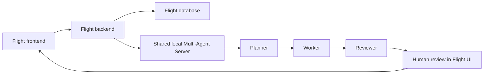

# Student 5 Release 2 Evidence Checklist

Student: **Yajun Ning**

Feature: **Flight Recommender**

Assigned workflow: **`.github/workflows/student-5-ci.yml`**

## Implemented contribution

- Integrated the Flight frontend and backend with the shared local Multi-Agent Server.
- Supplied Flight database records as evidence to Planner, Worker and Reviewer.
- Added frontend human decisions: accept, partial acceptance, correction and rejection.
- Added local pre-commit Ruff security, detect-secrets and pip-audit hooks.
- Added post-commit CI tests for two backend endpoint functions:
  - `POST /api/multi-agent/run`
  - `POST /api/multi-agent/<workflow_id>/decision`
- Added Student 5 Multi-Agent, Testing and Cloud Deployment agentic-loop review modes.
- Preserved the cloud baseline in which AI-Mode, MCP, RAG and Multi-Agent are disabled.

## Design flow



The frontend, backend and database are containerised. The Multi-Agent Server runs locally outside
Docker Compose and is reached from the backend via `host.docker.internal:5300`.

## Evidence to capture after running

1. Terminal showing the database, backend, frontend and shared Multi-Agent Server running.
2. Flight frontend showing Planner, Worker and Reviewer outputs.
3. Flight frontend showing a completed human decision and final workflow status.
4. Matching workflow entry from `ai-services/multi-agent-server/data/workflow_history.jsonl`.
5. Matching events from `ai-services/multi-agent-server/data/coordination_audit.jsonl`.
6. Successful pre-commit hook output for Ruff, detect-secrets and pip-audit.
7. Successful **Student YajunNing CI** run and downloaded `student-5-post-commit-evidence` artifact.
8. Cloud Flight frontend/core CRUD evidence with all four local AI flags disabled.
9. Generated validation logs in `student-YajunNing/reports/agentic-loop/`.

## Commands used for evidence

```bash
python -m pre_commit run --config student-YajunNing/.pre-commit-config.yaml --all-files
python -m pytest student-YajunNing/tests/post_commit/test_multi_agent_endpoints.py -v
python student-YajunNing/agentic_loop/main.py --mode multi-agent
python student-YajunNing/agentic_loop/main.py --mode testing
python student-YajunNing/agentic_loop/main.py --mode cloud
```

## Contribution log

| Date | Student 5 contribution | Evidence |
|---|---|---|
| 2026-10-21 | Flight Multi-Agent backend routes, database evidence and human review UI | Commit `5b135e5`, PR [#21](https://github.com/alvindhoedlyn/ASD_SPR_2026_GROUP15/pull/21) |
| 2026-10-21 | Pre-commit security scans and two post-commit endpoint tests | Successful CI [run 39561374713](https://github.com/alvindhoedlyn/ASD_SPR_2026_GROUP15/actions/runs/39561374713) and `student-5-post-commit-evidence` artifact |
| 2026-10-21 | Multi-Agent, Testing and Cloud review modes and report files | `reports/agentic-loop/` validation logs |

Add the refreshed Azure deployment URL and Student 5 CRUD evidence after PR #21 is merged and the
group cloud workflow is rerun.
